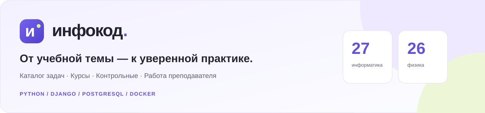
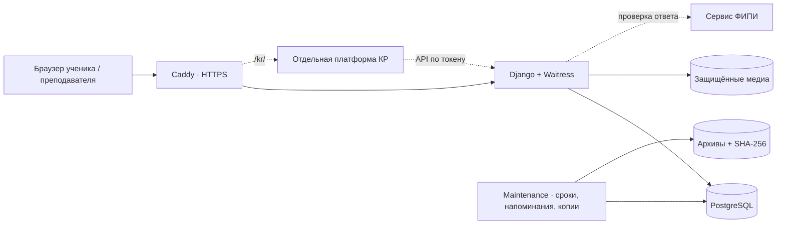

<p align="center">
  
</p>

<p align="center">
  <a href="https://github.com/MrFerrumL/infocode/actions/workflows/checks.yml"></a>
  
  
  
  
</p>

<p align="center">
  <a href="https://infocode1.ru"><strong>Рабочий сайт ↗</strong></a> ·
  <a href="docs/CASE_STUDY.md">Кейс проекта</a> ·
  <a href="docs/ARCHITECTURE.md">Архитектура</a> ·
  <a href="docs/SCREENSHOTS.md">Все скриншоты</a> ·
  <a href="GUIDE.md">Руководство</a>
</p>

**Инфокод** — платформа, которая объединяет подготовку к ЕГЭ, практику и работу преподавателя. Ученик решает задачи, проходит уроки и видит свой прогресс. Преподаватель собирает курсы и контрольные, назначает домашние задания и ведёт расписание.

В одном Django-приложении работают **два предмета — информатика и физика**. Серверный рендеринг, собственный JavaScript, PostgreSQL и отдельный сервис контрольных: от учебного сценария до развёртывания и резервного копирования.

> Рабочий сайт предназначен для учеников преподавателя: учебные разделы требуют входа. Для знакомства с проектом используйте скриншоты или запустите локальную версию с демонстрационными материалами.


*Снимки сделаны на локальной копии платформы. Имена и группы вымышленные, история решений демонстрационная. Количества на экранах относятся к моменту съёмки.*

## Что решает проект

Подготовка к экзамену обычно распределена между банком задач, конспектами, мессенджером и таблицей преподавателя. Инфокод связывает эти действия в один процесс: **изучить тему → решить задачи → получить обратную связь → повторить слабое место**.

| Для ученика | Для преподавателя |
|---|---|
| Полное условие и проверка ответа прямо в каталоге | Конструктор задач, уроков и проверяемых шагов |
| Подборки, похожие задачи и персональная тренировка дня | Назначение ДЗ и КР, журнал и история попыток |
| Курсы, конспекты, варианты с серверным таймером | Группы, доступы учеников и аналитика |
| Прогресс по номерам и работа над ошибками | Расписание и таблица пройденных тем |

## Как это выглядит

<table>
  <tr>
    <td width="50%"><strong>Практика без лишних переходов</strong><br>Условия, поиск и фильтры в одном каталоге.<br><br><a href="docs/screenshots/03-catalog.jpg"></a></td>
    <td width="50%"><strong>Рабочее место преподавателя</strong><br>Задания, ученики, сроки и очередь проверки.<br><br><a href="docs/screenshots/02-teacher-home.jpg"></a></td>
  </tr>
  <tr>
    <td><strong>Курсы и учебные материалы</strong><br>Разделы, уроки, шаги и прогресс прохождения.<br><br><a href="docs/screenshots/10-course.jpg"></a></td>
    <td><strong>Вариант в формате экзамена</strong><br>Таймер, сохранение ответов и навигация по заданиям.<br><br><a href="docs/screenshots/09-exam.jpg"></a></td>
  </tr>
</table>

**[Открыть галерею →](docs/SCREENSHOTS.md)** — конспекты Colab, похожие задачи, аналитика, расписание, физика, мобильный интерфейс, темы и контрольные.

## Основные возможности

- **Каталог и практика.** Поиск по тексту и ID, фильтры сложности и источника, файлы данных, история ответов, избранное. Связанные задания 19–21 объединяются в одну карточку с тремя ответами.
- **Персональная подготовка.** До восьми задач в тренировке дня: ошибки, слабые номера и новые темы. Похожие задачи ранжируются по векторам условий; локальная ONNX-модель обновляет векторы новых и изменённых задач в фоне. Без модели остаются готовые связи и подбор по номеру/сложности.
- **Курсы и конспекты.** Визуальные блоки текста, кода, медиа и тестов; черновики, версии и предпросмотр. Импорт `.ipynb` сохраняет Markdown, изображения и вывод кода.
- **Работы и прогресс.** Варианты, домашние задания с повторами, обязательные КР, ручная проверка, комментарии, CSV и аналитика по ученикам.
- **Два предмета.** У информатики и физики свои материалы и результаты учебных разделов; аккаунты, группы и расписание общие.
- **Работа преподавателя.** Выдача доступа, группы, приглашения, таблица пройденных номеров и календарь с повторениями и напоминаниями.
- **Генерация новых задач.** Для №23 реализованы собственные генераторы: ответ проверяется двумя независимыми алгоритмами, совпадения параметров и условий отбрасываются.

## Инженерные решения

| Задача | Реализация |
|---|---|
| Сохранить историю после правки контента | Версии шагов курса и снимки заданий в выданных вариантах |
| Не доверять таймеру в браузере | Серверный срок попытки и завершение просроченных работ обслуживающим процессом |
| Разделить предметы без дублирования аккаунтов | Контекст предмета, middleware и менеджеры моделей с предметной фильтрацией |
| Переносить большие банки и вложения | Подготовка пакетов, SHA-256, пробный импорт, потоковая обработка крупных файлов |
| Давать рекомендации без внешнего LLM-запроса | Локальная модель, сохранённые векторы и резервный подбор при отсутствии модели |
| Обновлять VPS при нестабильном SSH | Сценарий установки отдельно от SSH-сеанса, журнал завершения и предварительная копия |
| Восстанавливаться после ошибки | Проверяемые архивы данных и медиа, ротация после успешной проверки, восстановление в пустую среду |

Подробнее о сценариях, ограничениях и компромиссах — **[кейс проекта](docs/CASE_STUDY.md)**.

## Архитектура



Основное приложение находится в этом репозитории. Сервис **«Инфокод · КР»** — отдельный проект: здесь реализованы интеграция, API банка и вход преподавателя через подписанную ссылку. Его интерфейсы показаны в [галерее](docs/SCREENSHOTS.md#контрольные-без-регистрации).

**[Подробная схема, границы сервисов и путь запроса →](docs/ARCHITECTURE.md)**

## Технологии

| Слой | Стек |
|---|---|
| Backend | Python, Django 5.2, Waitress, WhiteNoise |
| Данные | PostgreSQL 16 на сервере, SQLite для локального запуска |
| Frontend | Шаблоны Django, HTML, CSS, JavaScript без SPA-фреймворка |
| Инфраструктура | Docker Compose, Caddy, Ubuntu VPS, GitHub Actions |
| Интеграции | ФИПИ, API платформы КР, Colab/Jupyter, CSV и календарь `.ics` |
| Данные и рекомендации | Пакетный импорт, обработка документов, multilingual-e5-small / ONNX Runtime, сохранённые эмбеддинги |

Серверный рендеринг позволяет держать формы, права доступа и проверку ответов в одном приложении. JavaScript отвечает за интерактивность; Node.js для запуска не требуется.

## Запустить локально

Установите **Python 3.12**, затем:

```bash
git clone https://github.com/MrFerrumL/infocode.git
cd infocode
python start_local.py
```

В Windows вместо `python` можно использовать `py`. Первый запуск создаёт `.venv`, устанавливает зависимости, применяет миграции и добавляет демонстрационные задания. Откройте **http://127.0.0.1:8000/**.

При отсутствии администратора создаётся `admin` со случайным паролем: данные появляются в терминале и локальном `.local-credentials.txt`. Повторный запуск сохраняет базу. Остановка — Ctrl+C.

**Внешние банки, рабочая база и медиа не поставляются вместе с клоном.** Чтобы посмотреть собственные материалы по физике после первоначального запуска, остановите сервер и выполните:

```powershell
# Windows
.\.venv\Scripts\python.exe manage.py seed_physics
python start_local.py
```

На Linux используйте `.venv/bin/python`. Для VPS и переноса данных — [DEPLOYMENT.md](DEPLOYMENT.md), для остальных команд — [GUIDE.md](GUIDE.md).

## Проверки и эксплуатация

```bash
python manage.py check
python manage.py makemigrations --check --dry-run
python manage.py test learning --noinput
```

Команды выполняются в окружении с установленными зависимостями. В [GitHub Actions](.github/workflows/checks.yml) настроены проверки с SQLite и PostgreSQL, сборка контейнера и запуск производственной конфигурации. Текущий статус — в значке CI наверху.

Состояние последнего проверенного прогона и известные проблемы описаны в [заметке о качестве](docs/QUALITY.md). Настроенный workflow не означает, что все его проверки уже проходят.

На сервере `check_content --strict` проверяет миграции и ссылки на материалы, `/health/` используется для проверки работоспособности, `maintenance` обслуживает сроки, напоминания и ежедневные копии.

## Границы проекта

- Python-код ученика сохраняется для просмотра преподавателем, но **не исполняется** сервером.
- События ухода со страницы в сервисе КР — сигналы для преподавателя, а не доказательство списывания и не прокторинг.
- Часть проверок зависит от внешнего сервиса ФИПИ; недоступность обрабатывается отдельно от неверного ответа.
- Тренировочный подсчёт баллов не заменяет экспертную проверку развёрнутых решений.
- Учебные материалы имеют собственные источники и условия использования. Объём рабочего банка зависит от импортированных пакетов; репозиторий показывает приложение и инструменты подготовки.

## Документация

| Хочу посмотреть… | Куда перейти |
|---|---|
| Продуктовую задачу и решения | [Кейс проекта](docs/CASE_STUDY.md) |
| Интерфейсы и функции | [Галерея скриншотов](docs/SCREENSHOTS.md) |
| Архитектуру и основные модули | [Техническая архитектура](docs/ARCHITECTURE.md) |
| Текущий статус проверок | [Качество и известные проблемы](docs/QUALITY.md) |
| Запуск, импорт и команды | [Общее руководство](GUIDE.md) |
| Сервер, перенос и копии | [Развёртывание](DEPLOYMENT.md) |
| Работу преподавателя | [Кабинет и контент](ADMIN_GUIDE.md) |
| Доступ учеников | [Ученики](STUDENTS.md) |
| Курсы и Colab | [Конспекты](NOTEBOOKS.md) |
| Предмет физика | [Физика](PHYSICS.md) |

---

Разработка и сопровождение: **[MrFerrumL](https://github.com/MrFerrumL)**.
