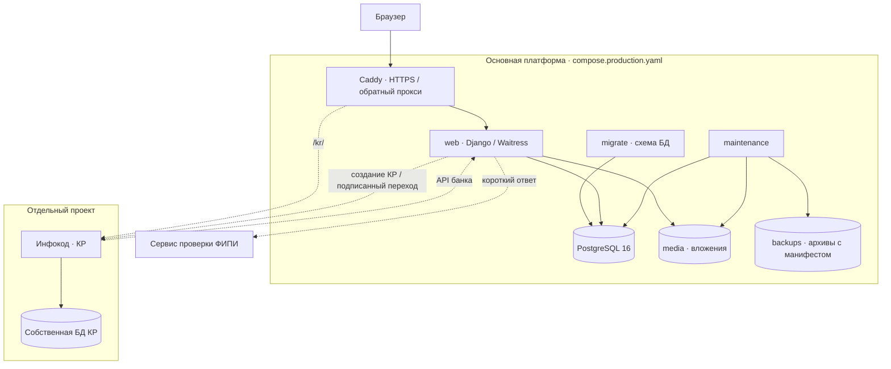
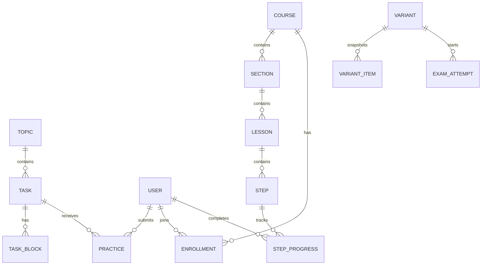
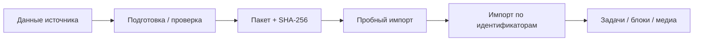

# Техническая архитектура

[Обзор проекта](../README.md) · [Кейс](CASE_STUDY.md) · [Развёртывание](../DEPLOYMENT.md)

Документ описывает опубликованную версию приложения, на базе которой оформлено портфолио. Незавершённые локальные изменения и рабочая база в состав документации не включены.

## Компоненты

### Что запускает Compose

| Сервис | Ответственность |
|---|---|
| `db` | PostgreSQL и постоянное хранение в `pgdata` |
| `migrate` | Применение миграций перед запуском приложения |
| `web` | HTML-страницы, ответы, права, импорт и защищённая выдача файлов |
| `maintenance` | Просроченные попытки, напоминания и ежедневные копии |
| `caddy` | Публичные порты 80/443, сертификаты, маршрутизация |

Сервис КР развёртывается отдельно. Его подключение предусмотрено конфигурацией прокси и переменными окружения; основной сайт может работать без включённой интеграции.

## Основные сущности

Это обзор связей, а не полная схема: назначения, группы, конспекты, расписание и служебные модели описаны в соответствующих Python-модулях и миграциях.

## Путь ответа ученика

1. Django получает запрос с сессией пользователя. Middleware устанавливает текущий предмет и проверяет общие ограничения доступа.
2. Представление каталога выбирает опубликованные задачи текущего предмета с фильтрами и пагинацией.
3. Форма ответа передаёт данные с CSRF и контекстом задачи; сервер проверяет доступ и формат.
4. Для обычных задач используется серверная проверка ответа. Для задач ФИПИ без известного ответа подключается внешний адаптер; недоступность сервиса отделена от результата «неверно».
5. Попытка сохраняется в истории. Ответ интерфейсу содержит результат и доступные материалы разбора.
6. JavaScript обновляет карточку. Базовый серверный сценарий формы остаётся предусмотрен без асинхронного обновления.

В экзамене действует отдельный жизненный цикл: ответы сохраняются в попытке, срок рассчитывается сервером, разбор открывается по правилам завершения работы.

## Изоляция предметов и пользователей

- Выбор предмета хранится в сессии; `SubjectMiddleware` устанавливает `contextvar` на время запроса.
- Менеджеры предметных моделей ограничивают стандартные выборки. Явная работа со всеми предметами доступна через `all_objects`.
- Ученик, преподаватель и администратор получают разные представления и разрешения. Проверяется не только роль, но и доступ к конкретной работе, группе или файлу.
- Само знание URL вложения не заменяет проверку доступа обработчиком файла.

Модуль: [`learning/subjects.py`](../learning/subjects.py). Проверки: [`learning/test_physics.py`](../learning/test_physics.py), [`learning/test_platform.py`](../learning/test_platform.py).

## Учебный контент и история

Условие и разбор задачи состоят из блоков. Курс строится из разделов, уроков и шагов; у шага есть версия содержания. Конспект является отдельным документом с ячейками и может подключаться к слайду курса.

Выданный вариант сохраняет снимок задания. Изменение банка не должно молча менять уже выданную работу. История прежних ответов курса сохраняется, даже если новая версия требует повторного прохождения.

## Подготовка и загрузка данных

Инструменты в `deploy/` готовят материалы; команды `learning/management/commands/` устанавливают их в приложение. Обычный повторный импорт существующих карточек не переписывает редакторские изменения. Большие файлы обрабатываются потоком.

В репозитории есть собственный банк физики и демонстрационное наполнение. Полный банк и пользовательские данные хранятся вне Git. Отдельные команды наполнения имеют разные правила обновления — точные ограничения указаны в руководствах импорта.

## Интеграция с платформой КР

`learning/kr_api.py` отдаёт доступные номера, сформированный набор задач и вложения. Запросы защищены `KR_API_TOKEN`; пустой токен отключает доступ. Сервис КР сохраняет свою копию материалов.

`learning/kr_client.py` обращается к отдельному сервису по внутреннему адресу. Для перехода преподавателя используется короткоживущая подписанная ссылка. Токен и рабочие адреса задаются окружением, а не значениями в публичной документации.

Сигналы переключения вкладок относятся к возможностям отдельного сервиса КР и не превращают основную платформу в систему прокторинга.

## Эксплуатация

- `/health/` и Compose health checks проверяют работоспособность приложения.
- `check_content --strict` диагностирует текущие данные и ссылки на медиа без изменения базы.
- `backup_platform` сохраняет данные и вложения с манифестом, проверяет архив перед публикацией результата.
- `run_maintenance` завершает просроченные попытки, отправляет напоминания и обслуживает ежедневные копии.
- Установщик сохраняет код и данные, запускает удалённый сценарий отдельно от SSH и следит за журналом.

Рабочие секреты, учётные данные учеников, БД и архивы исключаются из Git. Инструкция по первой установке и восстановлению: [DEPLOYMENT.md](../DEPLOYMENT.md).

## Карта кода

| Зона | Модули |
|---|---|
| Запрос и настройки | `config/`, `learning/middleware.py`, `learning/subjects.py` |
| Каталог и ответы | `learning/models.py`, `learning/views.py`, `learning/services.py` |
| Курсы | `learning/course_services.py`, `learning/course_views.py`, `learning/content_editor.py` |
| Конспекты | `learning/notebooks.py`, `learning/ipynb_import.py` |
| Преподаватель и работы | `learning/studio_views.py`, `learning/platform_views.py`, `learning/assignments.py` |
| Расписание | `learning/schedule_models.py`, `learning/schedule_services.py`, `learning/schedule_views.py` |
| Внешние сервисы | `learning/fipi_check.py`, `learning/kr_api.py`, `learning/kr_client.py` |
| Интерфейс | `templates/`, `static/` |
| Проверки | `learning/test_*.py`, `.github/workflows/checks.yml` |
